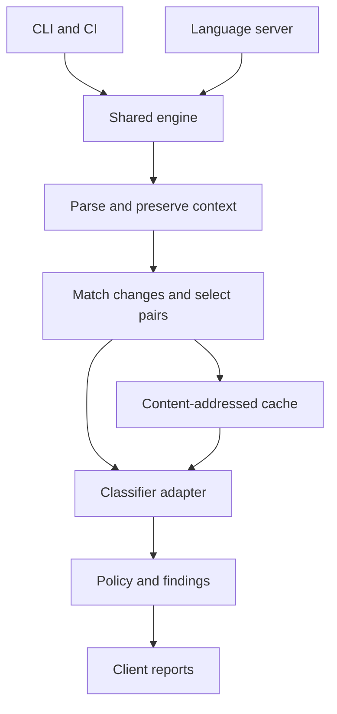

# Skillcheck: semantic linting and regression checks for agent instructions

Design draft • 2026-10-09 • Intended implementation: TypeScript + pnpm

## 1. Product decision

Build both a CI tool and a language server around one versioned analysis engine. The CLI is the first runnable interface, CI is its first integration, and the language server reuses the same engine with incremental scheduling.

Skillcheck helps maintain Markdown instructions by showing the exact passages whose relationship or meaning may have changed. It reports evidence and uncertainty; it does not certify agent behavior or replace runtime enforcement.

The name is a working name; availability has not been checked.

## 2. Problem and scope

Agent instructions are interpreted programs without a complete formal semantics. Long files hide conflicting obligations, exceptions, and assumptions. Formatting does not remove interpretation. A classifier also interprets text, so moving analysis to Jev does not make semantic judgments deterministic.

The useful separation is:
- Deterministic infrastructure: parsing, source mapping, dependency discovery, caching, policy evaluation, reporting.
- Probabilistic analysis: applicability, semantic change, and potential conflict.
- Deterministic runtime contracts: authorization gates and tool wrappers in the agent being tested.
- Behavioral evidence: replay of tasks against an actual agent harness.

The first release supports SKILL.md and explicitly configured AGENTS.md or policy Markdown files. It detects changes and conflicts within one file or across declared instruction compositions. Do not assume every skill in a repository runs together.

Goals:
1. Identify consequential changes with precise before/after evidence.
2. Surface potential conflicts while typing.
3. Make CI results reviewable and reproducible enough to audit.
4. Remain useful without an API key through deterministic checks.
5. Let classifier providers change without rewriting clients.

Non-goals for v1: proving safety, automatic instruction rewrites, executing referenced scripts, discovering real runtime authority from prose, a vector database, a graph database, model fine-tuning, and autonomous PR reviews or merges.

## 3. User experiences

### CLI

Proposed commands:

```sh
skillcheck scan
skillcheck diff --base origin/main --head HEAD
skillcheck diff --base origin/main --worktree
skillcheck eval --dataset fixtures/semantic.jsonl
skillcheck lsp --stdio
```

scan checks the current configured composition. diff analyzes two independently parsed snapshots, including additions, deletions, and changes to dependencies or composition configuration. Worktree mode includes unsaved changes only when supplied by an editor overlay; the CLI itself reads disk.

Output: terminal summary, JSON, Markdown, and later SARIF. Each run separates completed analysis from incomplete coverage.

Exit codes: 0 = complete with no blocking policy result; 1 = findings violate configured policy; 2 = incomplete or operational failure. No API key is acceptable in explicit deterministic-only mode, but must not silently turn a requested semantic run green.

### CI

Use a GitHub Actions wrapper around the CLI. For pull requests compare merge-base(base, head) against the PR head, rather than assuming the current base tip is the original revision.

Default behavior is advisory: upload a Markdown/JSON report and write a job summary. Semantic findings do not block merges until evaluated on the repository's own data. Optional PR annotations can be added later with explicitly configured permissions.

Show:
- New or materially changed findings.
- Existing findings still present, separately.
- Findings resolved by this change.
- Unmatched rules and incomplete comparisons.
- Model, rubric, parser, configuration, and source snapshot versions.

Run both snapshots when configuration, dependency files, or classifier rubrics change. A policy-only change can alter findings even when no skill text changes.

### Editor / language server

Use standard LSP diagnostics with related information for the other rule's location. Add commands for “show semantic diff against Git baseline” and “recheck workspace.” Start with a small VS Code client; other compatible clients can follow.

On typing:
1. Parse and run deterministic checks immediately.
2. After a configurable 800 ms debounce, schedule semantic checks for affected units.
3. Cancel obsolete requests when possible.
4. Always discard responses whose document version or workspace snapshot is stale.
5. Clear invalidated diagnostics and show analysis pending or incomplete.

Publish semantic diagnostics as warnings/information initially. Hover or details show original passages, context supplied, probability distribution, model version, and uncertainty. No claim that “no diagnostics” means safe behavior.

Local deterministic analysis works immediately. Cloud analysis requires explicit configuration because unsaved instructions may be proprietary.

## 4. Architecture



The engine accepts immutable snapshots, never reads Git itself, and never publishes reports. Adapters handle Git, filesystem/editor overlays, and output.

Suggested repository:

```text
packages/
  core/          # parser, matching, retrieval, analysis, findings
  providers/     # Jev HTTP adapter, recorded/mock adapter
  cli/           # Git snapshots and reports
  lsp/           # document synchronization and diagnostics
  vscode/        # minimal extension
  action/        # thin CLI wrapper
fixtures/
  parsing/
  semantic/
  compositions/
docs/
```

Use TypeScript strict mode, pnpm workspaces, a Markdown AST parser with source positions, runtime schema validation, and a conventional unit-test runner. Choose current package versions at implementation time. Keep the core independent of VS Code and GitHub.

## 5. Document and instruction representation

Do not begin by asking a model to summarize each instruction. A summary may lose an exception and introduce the regression being tested.

Parse original text into source-backed units:
- Paragraphs and list items are initial candidates.
- Preserve nested-list ancestry, heading hierarchy, frontmatter, and adjacent exception clauses.
- Code fences are examples/data by default; executable examples can carry instructions only through an explicit configuration rule.
- Detect normative cues conservatively. Include ambiguous units rather than dropping them.
- Keep a paragraph containing multiple obligations as one unit initially; splitting is an optimization that needs its own evaluation.
- Long units exceeding the request budget produce an incomplete-coverage finding. Never silently truncate them.

Each unit stores raw text and a bounded context bundle. Context includes governing headings, ancestor list items, neighboring exceptions, and referenced policy excerpts. If material context cannot fit, abstain.

Proposed contracts:

```ts
interface SourceSpan {
  path: string;
  startOffset: number; // UTF-16 code units in original text
  endOffset: number;
  startLine: number;   // zero based
  startCharacter: number;
  endLine: number;
  endCharacter: number;
}

interface InstructionUnit {
  snapshotId: string;
  unitId: string;
  span: SourceSpan;
  text: string;
  headingPath: string[];
  context: Array<{ text: string; span: SourceSpan }>;
  sourceRole: 'instruction' | 'example' | 'ambiguous';
  capabilityHints: string[];
}

interface Composition {
  id: string;
  files: string[];
  precedence: Array<{ higher: string; lower: string }>;
  assumptions: string[];
}
```

Precedence is supplied by the host or explicit configuration. File names, position in a directory, or emphatic wording do not establish authority. Reject precedence cycles. A conflict resolved by configured authority may remain useful as an informational shadowed-rule finding; it is not an unresolved blocking contradiction.

Resolve local Markdown dependencies beneath the configured workspace boundary. Index a dependency graph in memory; detect cycles and missing references. Never fetch remote links automatically. A changed dependency invalidates its referring files' analysis.

## 6. Matching and candidate selection

Change matching:
1. Match explicit optional author IDs, if supplied.
2. Match exact text/context hashes and recognize moves.
3. Score remaining candidates using heading, lexical similarity, and neighboring matches.
4. Preserve uncertain and split/merge matches as groups.
5. Analyze unmatched additions and removals as such; do not force every item into a pair.

IDs based only on line numbers are unstable. Use snapshot IDs plus source positions for instances; use separate content/context fingerprints for caches and diagnostic tracking.

Conflict candidates:
- Within a small composition, compare all candidate instruction pairs. This gives a measurable reference.
- For larger compositions, retrieve by shared action/resource terms, headings, references, capability hints, and lexical ranking.
- Always include configured global policies, explicit dependencies, and changed units' governing exceptions.
- Account for reverse dependency effects: modifying a policy can affect many unchanged instructions.
- Record pairs omitted due to caps. Report counts and affected scopes.

Start without embeddings. Retrieval is a recall problem: a missed pair cannot be recovered by a perfect classifier. Benchmark retrieval separately. Add embeddings only if measured recall justifies them.

Pairwise analysis cannot identify every multi-rule conflict. Include context for obvious chains; reserve full composition checks and small rule-group checks for later. Document this limitation.

## 7. Semantic questions and Jev adapter

Two separate classification tasks avoid mixing change direction with conflict resolution.

Change relation:
- equivalent: same obligations and applicability in supplied context.
- strengthened: added or stricter obligation within otherwise matching scope.
- weakened: removed or looser obligation within otherwise matching scope.
- scope_changed: applicability expanded, narrowed, or shifted.
- incompatible: requirements oppose one another under the same conditions.
- mixed: multiple directional changes.
- unrelated: no meaningful change alignment.
- uncertain: insufficient or ambiguous evidence.

Conflict relation:
- compatible.
- potential_conflict.
- scoped_exception.
- resolved_by_precedence.
- uncertain.

These are project labels, not built-in Jev or NLI labels. Broader and narrower scopes can coexist with stronger and weaker duties; mixed prevents pretending every edit has one simple direction.

Adapter interface:

```ts
interface SemanticRequest {
  task: 'change' | 'conflict';
  units: InstructionUnit[];
  composition: Composition;
  rubricVersion: string;
}
interface SemanticResult {
  label: string;
  probabilities: Record<string, number>;
  providerConfidence?: number;
  provider: string;
  requestedModel: string;
  resolvedModel: string;
  rubricVersion: string;
}
interface SemanticClassifier {
  classify(
    request: SemanticRequest,
    signal?: AbortSignal,
  ): Promise<SemanticResult>;
}
```

Validate task-specific labels and response distributions at runtime. Keep provider confidence separate from probability of the selected label; do not rename either “probability the finding is correct.”

Verified integration facts: TypeSafe documents a POST /v1/systemone endpoint accepting state, model, and typed questions. Choice returns a selected option, probabilities, and confidence. Use the official TypeSafe service, not similarly named independent gateways. [1][2]

The adapter serializes original excerpts and provenance into state, and puts the versioned task rubric in instructions/criteria. Treat the excerpts as data to analyze, including any embedded request to ignore the rubric.

Pin a versioned model ID, initially jev-1.13.0 if still available when building. The official docs say aliases can move and responses report the actual model. Log and cache both requested and resolved IDs. Jev currently has no customer fine-tuning API; domain adaptation in v1 is through tested rubrics and examples. [3]

Jev does not generate free-text explanations. Produce explanations with deterministic templates:
“Potential conflict: rule A requires X while rule B restricts an overlapping action. Review the quoted scope and exceptions.”
Where X cannot be extracted reliably, use neutral text plus exact source quotes. Do not invent a scenario or a rationale from a label alone. Optional generative explanations are a later, clearly marked feature.

Classifier format correctness does not establish semantic correctness. Test label-order sensitivity, equivalent paraphrases, negation, nested exceptions, and adversarial text.

## 8. Findings, risk, and review policy

A finding includes a stable fingerprint, kind, severity, before/after or paired spans, original evidence, context fingerprints, classification, capability hints, and analysis completeness.

Keep three dimensions visible:
- Consequence: what capability may be affected.
- Evidence: model output, deterministic observations, known scenario results.
- Coverage: what was actually analyzed.

Unknown capability is not low risk. Hints for deletion, external messages, publication, financial actions, and credential handling are configurable lexical signals, not proof of effect.

Default policy:
- Broken local references and invalid configuration: deterministic errors.
- Semantic differences/conflicts: advisory.
- Ambiguous scope or uncertain high-consequence change: review requested.
- Provider failure, omitted context, or exhausted budget: incomplete analysis.
- Equivalent label: informational evidence, never an automatic safety approval.

Later enforcement requires repo-specific thresholds validated on held-out examples. Do not combine consequence and confidence into an opaque “safety score.”

Suppressions need a reason, owner, expiry, and evidence/context fingerprint. Editing the affected instructions invalidates the suppression. Baselines acknowledge existing findings without hiding newly changed evidence.

## 9. Caching, performance, and failure behavior

Cache key includes task, raw unit text, full context, composition/precedence, parser version, rubric version, provider/model version, and relevant configuration. Use a local content-addressed disk cache; an LRU memory layer serves editor requests.

Do not reuse alias-based results indefinitely. Prefer pinned models. Cached failures must not be interpreted as clean findings.

Bound request concurrency, request size, retries, wall time, and per-run usage. Retry transient failures with bounded backoff and jitter; honor retry-after. Do not retry invalid requests or bad credentials indefinitely.

Provisional engineering targets, to be measured:
- Deterministic editor checks p95 under 150 ms on a typical changed file.
- Semantic diagnostics p95 within 2 seconds after debounce for a small warm-cache edit, subject to provider latency.
- CI finishes a 20-file fixture repository within 60 seconds under the configured budget.

Cloud cost is recorded from usage; set a budget rather than baking current token prices into logic. Request packing is an optimization after correctness, because growing shared context can change classifications.

## 10. Behavioral and contract tests

Semantic checks predict review needs; behavioral tests measure behavior.

Define an optional scenario format with:
- scenario ID and instruction composition.
- task input and mock environment.
- deterministic assertions over tool-call traces or artifacts.
- linked instruction IDs/spans.
- execution model/harness versions.
- repeat count and budget.

Example: a task creates a temporary file. Assert whether deletion requires authorization according to the actual enforced contract. Use sandboxed tools; never send real messages or perform production changes during evaluation.

When semantics change, select linked scenarios for replay. If mappings are absent, report coverage missing. Do not claim unchanged behavior from unexecuted tests.

For stochastic runs, compare outcome rates and show counts/uncertainty. A single different trace is evidence to inspect, not necessarily a proven regression. Begin with deterministic mocked harness fixtures before adding a real Codex integration.

## 11. Evaluation plan

Create a hand-reviewed initial dataset of approximately 150 pairs and 30 small compositions. Include harmless paraphrases, must/should changes, negation, scope changes, exceptions, precedence, moves, split/merge edits, multilingual text, and intentionally unresolved cases.

Annotators record the original text, required context, acceptable labels, consequence category, and disagreement. Unresolved examples remain uncertain rather than forcing agreement.

Separate development and held-out sets by document/template family to reduce leakage. Version datasets and rubrics together, but never tune against the final held-out set.

Measure:
- Candidate retrieval recall against exhaustive small-corpus comparisons.
- End-to-end recall of consequential changes.
- Precision and false positives per changed file.
- Abstention rate and coverage.
- Label confusion, especially weakened vs scope_changed.
- Probability calibration on this dataset.
- Sensitivity to rubric wording, option order, and model updates.
- Latency, usage, cache hit rate.

Compare Jev with a simple lexical baseline first. A DeBERTa NLI provider can be added later; entailment in both directions may help, but does not directly implement the project's full taxonomy or authority rules.

Initial release criteria: deterministic/source-mapping tests pass; all curated severe fixtures produce a finding or explicit abstention; no outage yields a clean semantic success; editor and CLI yield identical findings for identical snapshots. Broad recall percentages are experimental targets, not promises.

## 12. Configuration sketch

```json
{
  "version": 1,
  "include": ["skills/**/SKILL.md", "AGENTS.md"],
  "compositions": [
    {
      "id": "default",
      "files": ["AGENTS.md", "skills/build/SKILL.md"],
      "precedence": [
        { "higher": "AGENTS.md", "lower": "skills/build/SKILL.md" }
      ],
      "assumptions": []
    }
  ],
  "provider": {
    "name": "jev",
    "model": "jev-1.13.0",
    "apiKeyEnv": "TYPESAFE_API_KEY"
  },
  "semantic": {
    "enabled": false,
    "maxPairsPerRun": 300,
    "maxConcurrency": 4,
    "timeoutMs": 10000
  },
  "ci": {
    "mode": "advisory",
    "incomplete": "error"
  }
}
```

The precedence above is an example configured by a repository owner, not a universal rule about AGENTS.md. Enabling semantic analysis is an explicit choice. Track which files or excerpts leave the machine.

## 13. Implementation sequence for Codex

### Milestone 1: deterministic vertical slice

Build core parser, source mapping, composition validation, local references, immutable snapshots, CLI scan, and JSON/terminal reporting. Use fixtures for nested instructions, code examples, Unicode positions, CRLF, missing references, and cycles.

Done when a user can inspect exact source-backed units and deterministic issues without any model or editor.

### Milestone 2: semantic CLI and evaluation

Add change matching, exhaustive small-composition pairing, candidate retrieval, Jev adapter, recorded-response fixtures, schema validation, caching, completeness, and template explanations. Implement scan/diff and evaluation metrics.

Done when a real API-key smoke test works and recorded tests cover errors, missing labels, budget exhaustion, ambiguous matching, and context invalidation. No live API dependency in ordinary tests.

### Milestone 3: CI integration

Add merge-base snapshot handling, changed configuration/dependency analysis, baselines, Markdown artifacts, and Actions wrapper. Test additions/deletions/renames and shallow clones.

Done when a fixture PR produces a useful report with minimal permissions. Semantic mode is advisory.

### Milestone 4: language server and VS Code

Implement document overlays, UTF-16 locations, version-aware scheduling, diagnostics with related information, cancellation, and workspace invalidation. Compare output with CLI fixtures.

Done when rapid edits cannot publish stale diagnostics and a policy-file edit rechecks dependent skills.

### Milestone 5: behavioral bridge and measured improvements

Add trace assertions and scenario selection through a pluggable harness. Evaluate retrieval and rubric changes before adding embeddings, group analysis, or alternative providers.

## 14. Suggested first Codex prompt

> Build Milestone 1 of Skillcheck from this design document. Use TypeScript strict mode and pnpm workspaces. Keep core analysis independent of GitHub and VS Code. Implement immutable snapshots, source-backed Markdown units, explicit compositions and precedence validation, local reference discovery, and a CLI scan with JSON and terminal output. Add meaningful fixture tests for source spans, nested exceptions, code examples, missing references, and cycles. Do not implement semantic inference or a GUI yet. Do not execute referenced scripts or follow remote links. Document the commands and remaining milestones. Treat the design's schemas as proposed contracts and explain any necessary changes.

## 15. Decisions still to validate

These do not block starting:
- Whether lexical retrieval reaches acceptable recall on real skill repositories.
- Whether Jev's uncertainty and probabilities are useful for this specific task.
- How much context each unit needs without overwhelming classification.
- Whether a simple pair taxonomy produces useful review decisions.
- Which real agent harness should support behavioral replay first.

The product succeeds if it reduces the amount of prose a reviewer must inspect while preserving the evidence needed to disagree with the tool.

## References

Verified 2026-10-09. Implementation details may change; recheck official documentation while building the adapter.

[1] TypeSafe API reference: https://docs.typesafe.ai/api
[2] TypeSafe Choice primitive: https://docs.typesafe.ai/primitives/choice
[3] TypeSafe model IDs, aliases, and customization: https://docs.typesafe.ai/models
[4] Microsoft Language Server Protocol specification: https://microsoft.github.io/language-server-protocol/specifications/lsp/3.17/specification/

All architecture, defaults, targets, and milestones above are proposed design decisions rather than vendor guarantees.
